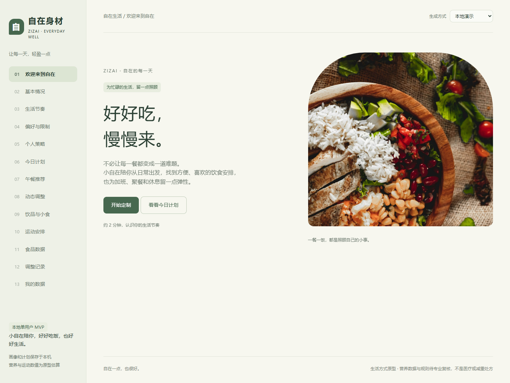
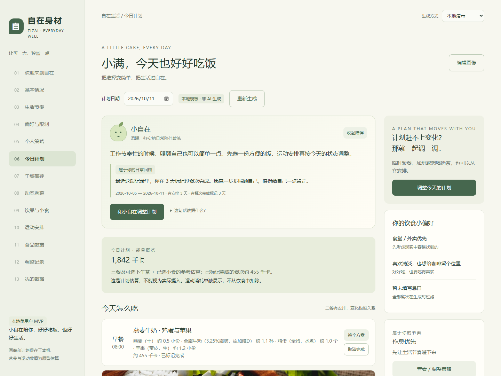
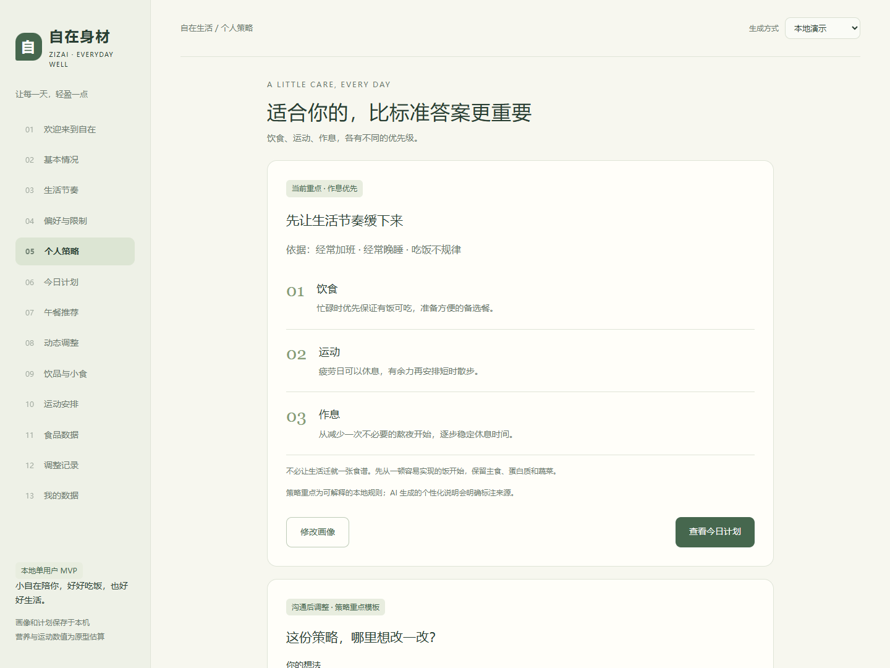
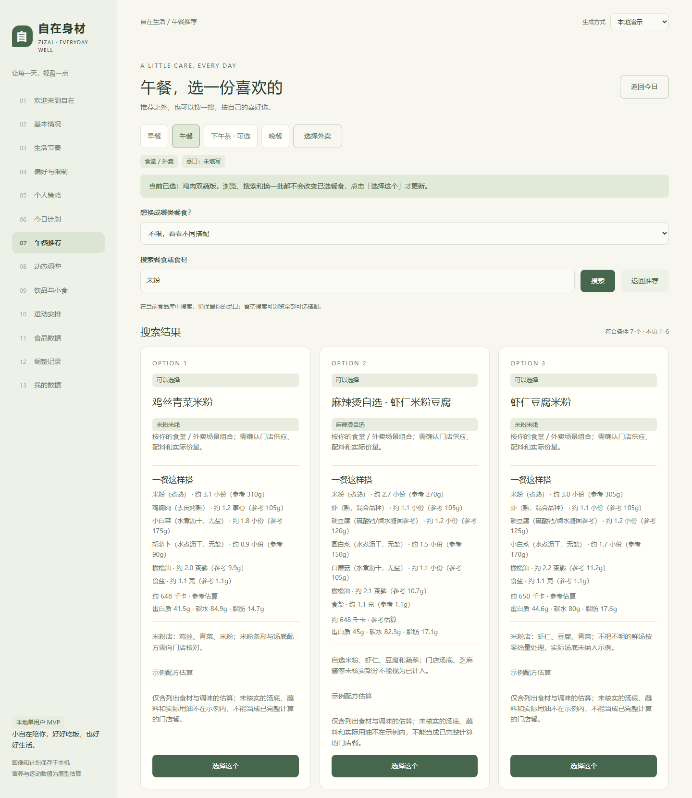
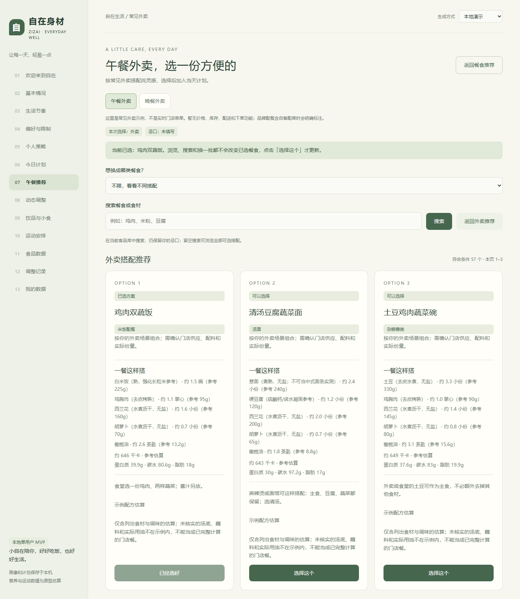
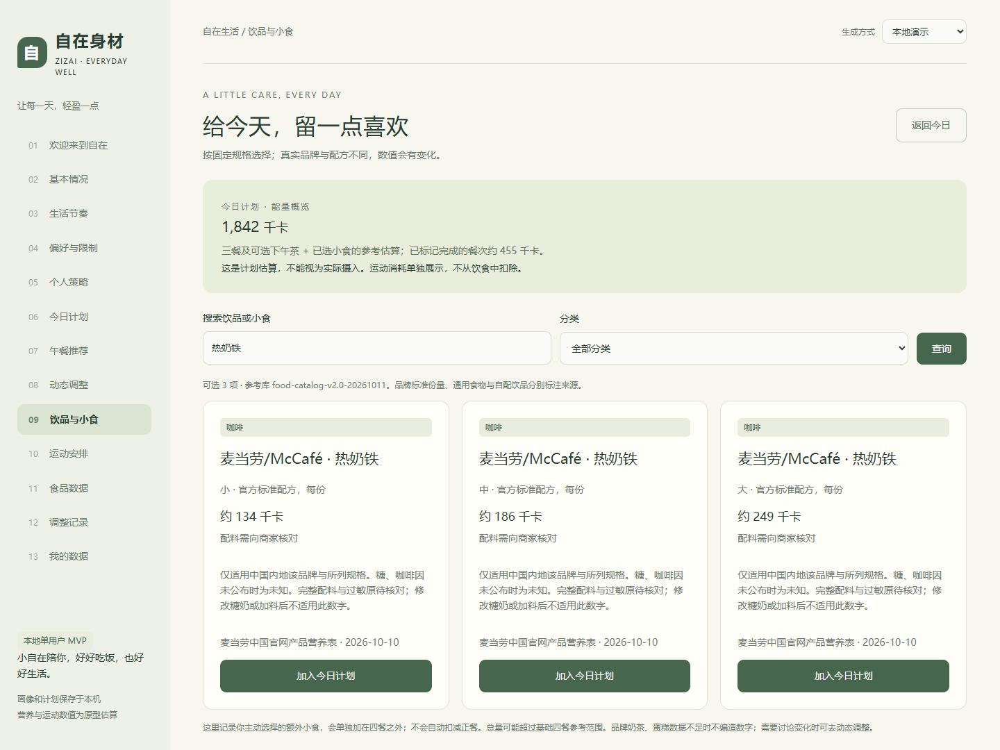
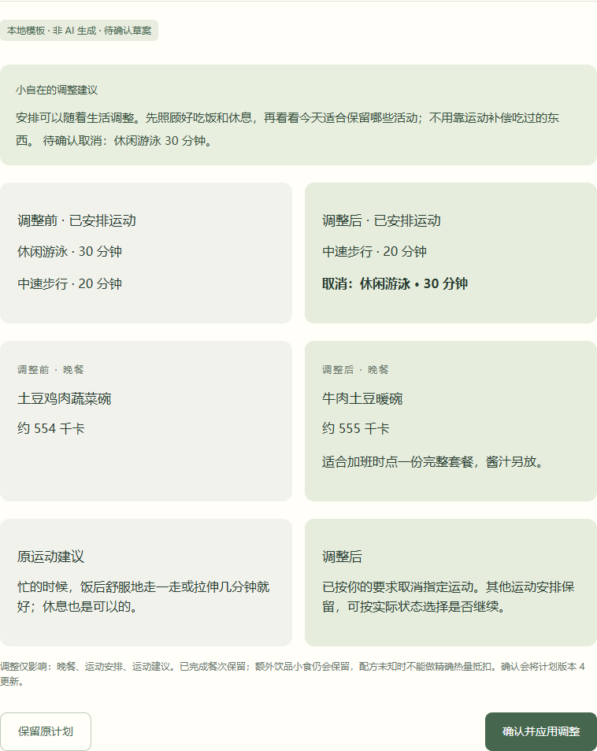
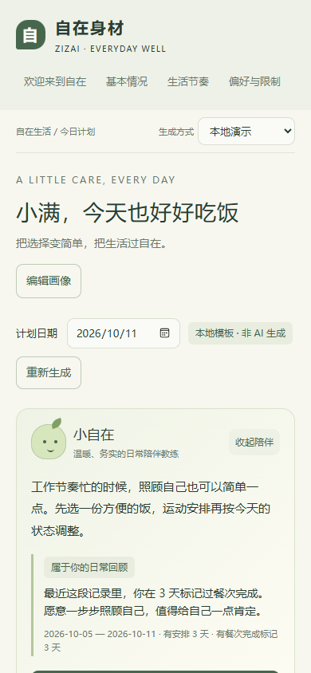

# 界面截图

2026-10-11 从实际运行的 v0.3.0 应用截取。全部使用合成画像“小满”和独立临时数据库，生成方式为“本地演示”；不包含日常个人数据库，不代表真实 DeepSeek 输出或真实用户执行效果。

## 1. 欢迎与产品定位

米白与柔和绿色配色，传达轻松的日常陪伴感。



## 2. 今日计划与小自在

陪伴反馈来自示例完成标记；能量概览表示计划估算。



## 3. 个性化策略

示例为经常加班、晚睡的画像，由本地规则匹配“作息优先”。



## 4. 搜索与自主选餐

搜索“米粉”，展示符合当前画像的搭配；浏览不直接修改已选餐食。



## 5. 常见外卖搭配

提供点餐灵感与换批，不是实时门店菜单。



## 6. 饮品规格与参考能量

同一饮品按规格展示，来源可追溯。



## 7. 动态调整与确认

画面为草案组件原始截图：取消游泳、保留步行、调整晚餐，确认前不改正式安排。



## 8. 移动端

390 × 844 视口截图，页面可继续下滑查看。



## 截图复现

可选脚本：`tests/portfolio_screenshots.cjs`。需要 Node.js、Playwright 与本机 Microsoft Edge；这些不是产品运行依赖。脚本创建临时数据库，用合成数据截图并在结束时删除测试数据库，不调用付费模型。

```powershell
node tests/portfolio_screenshots.cjs
```

若 Playwright 未安装，先在独立测试环境安装，或通过 `PLAYWRIGHT_PATH` 指定已安装包的路径；Python 可通过 `PYTHON` 环境变量指定。截图清单见 [capture-report.json](screenshots/portfolio/capture-report.json)。其他 `screenshots/` 文件是早期功能验收截图，README 使用本页的新截图。
